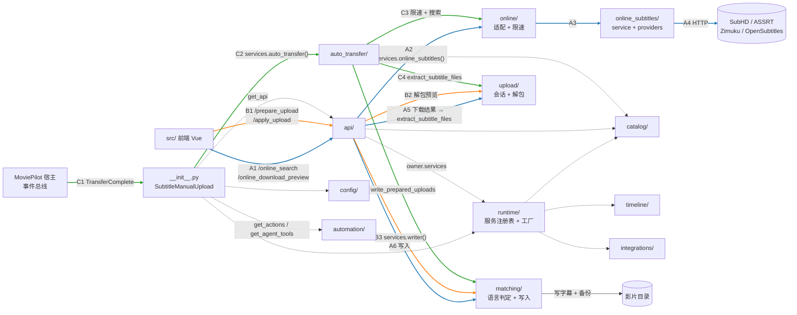

# 01 模块地图 · 海拉鲁字幕大师 V3（subtitlemanualupload）

> 任务：S1 P1-1-module-map ｜ 编写：2026-10-15
> 参考仓提交：`8146218`（2026-08-28 01:50 AM，UTC+8）｜ 插件版本 1.2.7 ｜ 许可证 GPL-3.0（见 `docs/api-notes/mp-v3-plugin.md` §6，本文不重复）
> 范围：`_reference/hailulu/plugins.v3/subtitlemanualupload/` 的 Python 部分；`src/` 只按文件名与 `<script>` 开头列职责；`dist/`、`wheels/`、`resources/` 跳过
> 方法：按 `README.md`「研读规则」。签名、导入关系用 Grep 提取，只分段读了入口、`service.py` 排序段、`models.py` 字段段、`upload_session.py` 常量段等少数位置
> 出处写法：`文件:行号`，路径相对插件目录；「推测」= 由命名/导入推断，「不确定」= 未能确认

---

## §1 概览

- 共 80 个 `.py`，约 **18,600 行**。其中 11 个是只有一行 docstring 的包 `__init__`，6 个是星号重导出的门面（`online_subtitles/__init__.py`、`core.py`、`common.py`、`captcha/__init__.py`、`providers/__init__.py`、`auto_transfer/__init__.py`），**实质模块 63 个**（含入口）。
- 架构特征（相对 §6 已有观察的补充）：
  1. **服务注册表 + 工厂注入**：入口的 `services` 属性懒加载 `runtime/service_registry.py`，各服务由 `runtime/service_factories.py` 构造（`__init__.py:368-373`）。所以 `api/`、`auto_transfer/` 与 `upload/`、`online_subtitles/` 之间几乎**没有直接 import**，而是通过 `owner.services.xxx()` 调用 —— 只看 import 图会低估耦合。
  2. **委托方法装到插件类上**：模块末尾 `install_shell_helpers(...)`（`__init__.py:389`）给类安装 `owner._xxx` 形式的委托方法（推测，依据 `runtime/shell_helpers.py:43-57` 的 `_service_accessor` / `_service_delegate` 命名），`auto_transfer` 的协作者就是这些方法（`auto_transfer/auto_transfer.py:40` 起 `from_owner`）。
  3. **兼容转发层**：`catalog/target_resolver.py`、`timeline/timeline_fixer.py` 重复定义了拆分后各模块的同名函数（如 `target_resolver.py:73-306` 对应 `target_normalizers.py` / `media_metadata.py`；`timeline_fixer.py:291-741` 的 `_xxx` 对应 `timeline_alignment/vad/cache.py`），推测为重构后保留旧导入路径。读代码时以拆分后的模块为准。

| 子包 | 一句话职责 | 实质文件数 | 行数 |
|---|---|---|---|
| 入口 `__init__.py` | 插件类、生命周期、事件订阅，全部委托给服务 | 1 | 394 |
| `api/` | 25 个 HTTP 端点（前端调用） | 8 | 1,548 |
| `online_subtitles/` | 字幕源引擎：4 个 Provider、关键词、相关性打分、HTTP 客户端、验证码 | 14 | 3,635 |
| `online/` | 插件侧对引擎的适配（限速）+ 在线结果转 AI 翻译 | 2 | 434 |
| `upload/` | 上传会话 + **压缩包解析**（zip/rar/7z）| 1 | 885 |
| `matching/` | 语言识别、写入改名与备份、历史、繁转简 | 4 | 1,633 |
| `catalog/` | 本地媒体索引、目标解析、现有字幕盘点、TMDb 元数据 | 7 | 2,915 |
| `auto_transfer/` | 整理完成后自动搜索写入：队列、限速、季包缓存、挑选策略 | 7 | 1,945 |
| `timeline/` | 智能调轴：音频 VAD + FFT 对齐 + 缓存 | 7 | 2,163 |
| `runtime/` | 服务注册表、工厂、委托安装、STRM 监控 | 6 | 1,006 |
| `config/` | 配置默认值、规范化、表单 | 2 | 797 |
| `automation/` | MP 工作流动作、智能体工具 | 3 | 761 |
| `integrations/` | 与 AI 字幕插件（AutoSub）桥接 | 1 | 475 |
| `utils/` | 空包 | 0 | 1 |

---

## §2 模块地图

「调用方」来自相对导入反查与 `services.xxx()` 调用点；标「推测」的未逐一核实。

### 2.0 入口 `__init__.py`（只补 §6 未写的）

| 位置 | 内容 |
|---|---|
| `__init__.py:161-175` | 类 `SubtitleManualUpload`，`plugin_order = 48`、`auth_level = 1`；类属性 `_rar_dependency_mode = "none"`（**默认不准备 RAR 工具**，痛点③线索）|
| `__init__.py:298-317` | `init_plugin` 顺序：规范化配置 → 写入实例/类属性 → 重置运行态 → 恢复媒体索引与匹配历史缓存 → 保存配置 → 准备 RAR 依赖 → 清理旧上传会话 → 启动 STRM 监控 |
| `__init__.py:337-341` | `get_render_mode` 返回 Vue + `dist/assets`；`get_api` → `api/routes.py:6 build_api_routes` |
| `__init__.py:326-335` | `get_actions` / `get_agent_tools` 在方法内延迟导入 `automation/` |
| `__init__.py:368-377` | `services` 懒加载注册表；`stop_service` 只停 STRM 监控与自动链路 |
| `__init__.py:379-383` | `TransferComplete` 处理器：检查启用与「整理后自动搜索」开关，委托 `services.auto_transfer().handle_transfer_complete` |

### 2.1 `api/`

| 文件 | 职责 | 关键类/函数 | 调用方 |
|---|---|---|---|
| `routes.py` | 路由表：25 条（路径→端点→方法） | `build_api_routes` (6) | 入口 `get_api` (`__init__.py:340`) |
| `online_api.py` | 在线搜索、按源搜索、手动链接、下载预览；**把在线下载结果送进解包器** | `OnlineApi` (66)：`online_search` 130、`online_search_provider` 184、`online_download_preview` 237；`download_online_results_to_uploads` (26) | routes；`online/online_ai.py:7` 反向导入 |
| `upload_api.py` | 手动上传：准备预览、应用写入、清除、删除、恢复备份 | `UploadApi` (25)：`prepare_upload` 108、`apply_upload` 204 | routes |
| `status_api.py` | 插件状态、刷新索引 | `StatusApi` (12) | routes |
| `catalog_api.py` | 媒体搜索、目标列表 | `CatalogApi` (9) | routes |
| `ai_api.py` | AI 字幕任务提交/查询/取消/重启 | `AiApi` (17) | routes |
| `timeline_api.py` | 调轴任务、对已有字幕调轴 | `TimelineApi` (14) | routes |
| `request_helpers.py` | 请求体解析：目标 ID、锁定检查、关键词、补媒体信息 | `target_ids_from_body` (13)、`online_keywords` (69) | api 各端点（推测） |

### 2.2 `online_subtitles/`（字幕源引擎）

| 文件 | 职责 | 关键类/函数 | 调用方 |
|---|---|---|---|
| `service.py` | 多源搜索编排：逐个 Provider 搜索 → 去重 → 排序 → 取前 80；下载分发 | `OnlineSubtitleSearchService` (11)：`search` 95、`download` 169 | 经 `core.py` 重导出给 `online/online_subtitle.py:4`；实例由 `runtime/service_factories.py:276 online_service` 构造（推测） |
| `providers/base.py` | Provider 抽象：`status / manual_url / search / search_all / download`；另有只给手动链接的 Provider | `BaseSubtitleProvider` (7)、`ManualSubtitleProvider` (64) | 4 个 Provider 继承 |
| `providers/subhd.py` | SubHD：搜索页解析、详情、下载（含验证码流程） | `SubHDProvider` (11)：`search_all` 27、`download` 344 | service |
| `providers/assrt.py` | ASSRT API | `AssrtProvider` (11) | service |
| `providers/zimuku.py`、`opensubtitles.py` | 另两个源 | `ZimukuProvider` (12)、`OpenSubtitlesProvider` (11) | service |
| `captcha/subhd.py`、`zimuku.py` | **验证码自动识别**（SVG / BMP） | `SubHDSvgCaptchaSolver` (5)、`ZimukuBmpCaptchaSolver` (5) | `providers/subhd.py:3`、`zimuku.py:3` |
| `clients.py` | HTTP 抓取（标准库 urllib，可选浏览器引擎）、直链下载、网络错误分类 | `OnlinePageClient` (44)、`OnlineDirectDownloader` (167)、`_content_magic` (234) | 各 Provider |
| `keyword_builder.py` | 从媒体信息构造多语种标题/别名关键词与查询计划 | `build_search_keywords` (96) | Provider；自动链路（推测） |
| `matcher.py` | 结果相关性评估、打分、源优先级 | `_assess_result_match` (249)、`_score_result` (40)、`_provider_priority` (56) | Provider、service |
| `language.py` | 从文本猜语言标签、字幕格式 | `_guess_language_label` (7)、`_guess_subtitle_format` (92) | Provider |
| `models.py` | 结果数据类、验证码异常 | `OnlineSubtitleResult` (8)、`CaptchaRequiredError` (75) | 全包 |
| `shared.py` | 杂项：链接提取、去重、豆瓣 IMDb 查询、验证码页识别 | `_dedupe_results` (274)、`_search_douban_subject` (191) | Provider、captcha、service |
| `core.py`、`common.py` 等 | 星号重导出门面 | — | `online/online_subtitle.py:4` |

### 2.3 `online/`

| 文件 | 职责 | 关键类/函数 | 调用方 |
|---|---|---|---|
| `online_subtitle.py` | 插件侧适配层：在线搜索限速检查等 | `check_online_rate_limit` (32) | `api/online_api.py:14`、`auto_transfer_processor.py:9`、`auto_transfer_season.py:11`、`config_schema.py:6`、runtime |
| `online_ai.py` | 在线结果准备成 AI 翻译任务（ASS→SRT） | `OnlineAiService` (16) | `services.online_ai()`：`api/online_api.py:259` |

### 2.4 `upload/`

| 文件 | 职责 | 关键类/函数 | 调用方 |
|---|---|---|---|
| `upload_session.py` | 上传会话目录管理；**压缩包识别与解包**（zip 用标准库，rar 用 rarfile 或外部工具，7z 用外部工具）；资源上限防护；RAR 依赖准备 | `UploadSessionService` (729)：`extract_subtitle_files` 779；`ArchiveSubtitleExtractor` (603)；`ArchiveDependencyService` (192)；`find_rar_tool` 145、`find_sevenzip_tool` 174 | `services.upload_session()`：`api/online_api.py:33,268`、`api/upload_api.py:78,149`、入口 316；自动链路协作者 `extract_subtitle_files`（推测） |

### 2.5 `matching/`

| 文件 | 职责 | 关键类/函数 | 调用方 |
|---|---|---|---|
| `subtitle_writer.py` | 生成目标文件名、写入操作、已有字幕备份；调轴结果不合格时拦截自动写入 | `SubtitleWriter` (150)、`build_destination_name` (17)、`build_write_operations` (32) | `services.writer()`：`api/upload_api.py:65`；入口 138 |
| `subtitle_language.py` | 语言后缀识别、内容语言检测、自动挑选的语言/格式排序键 | `detect_language_profile` (140)、`auto_subtitle_sort_key` (285) | auto_transfer、config、online_ai、integrations、runtime、入口 122 |
| `subtitle_history.py` | 匹配历史持久化 | `SubtitleHistory` (13) | `services.history()`：入口 313 |
| `tongwen.py` | 繁→简（读 `resources/tongwen` 词典） | `convert_subtitle_file_to_simplified` (49) | `runtime/service_factories.py:51` |

### 2.6 `catalog/`

| 文件 | 职责 | 关键类/函数 | 调用方 |
|---|---|---|---|
| `local_media_catalog.py` | 本地媒体索引：扫描、缓存、持久化、按 ID 解析目标 | `LocalMediaCatalog` (10) | `services.local_media_catalog()`：入口 312、`api/online_api.py:106,137` |
| `media_target_resolver.py` | 媒体条目 → 可写字幕的目标 | `MediaTargetResolver` (33) | `services.target_resolver()`：`api/online_api.py:109` |
| `media_metadata.py` | TMDb 别名/英文名、华语片判定 | `MediaMetadataService` (308)、`is_chinese_transfer_media` (250) | `services.media_metadata()` |
| `subtitle_inventory.py` | 影片现有字幕盘点 | `SubtitleInventory` (19) | `services.subtitle_inventory()` |
| `target_normalizers.py` | 路径、媒体类型、集数等规范化 | `is_local_video_path` (100) | catalog 内部（推测） |
| `target_resolver.py` | 兼容转发层 + 上传项自动配对目标 | `suggest_target` (327)、`auto_fill_missing_targets` (375) | `api/upload_api.py:19`、`auto_transfer_write.py:9`、`online_ai.py:10`、runtime |
| `manual_strm.py` | 手动登记的 STRM 目录 | `ManualStrmCatalog` (11) | `runtime/service_factories.py:48` |

### 2.7 `auto_transfer/`

| 文件 | 职责 | 关键类/函数 | 调用方 |
|---|---|---|---|
| `auto_transfer.py` | 自动链路门面：接事件、入队、后台 worker、批处理 | `AutoTransferService` (91)：`handle_transfer_complete` 302、`ensure_transfer_auto_worker` 319、`process_transfer_auto_task_batch` 493 | 入口 383；`runtime/service_factories.py:186` |
| `auto_transfer_processor.py` | 单条目：搜索 → 下载 → 解包 → 写入，必要时转 AI | `AutoTransferProcessor` (31)：`search_write_subtitle` 51、`process_entry` 282 | auto_transfer.py（推测） |
| `auto_transfer_write.py` | 按语言/格式偏好挑选并写入 | `AutoTransferWriteStrategy` (26)：`select_subtitle_items` 70、`write_prepared_uploads_for_entries` 114 | `auto_transfer.py:439-447` |
| `auto_transfer_season.py` | 剧集季包缓存、按季搜索 | `AutoTransferSeasonCache` (34) | `auto_transfer.py:463-489` |
| `auto_transfer_queue.py` | 任务队列与状态 | `AutoTransferQueue` (15) | auto_transfer.py |
| `auto_transfer_rate_limit.py` | 在线搜索限速 | `AutoTransferRateLimiter` (9) | auto_transfer.py |
| `auto_transfer_models.py` | 任务字典构造、对外视图 | `build_auto_transfer_task` (10) | queue（推测） |

### 2.8 `timeline/`（调轴，本项目 F7.3 才可能用到）

| 文件 | 职责 | 关键类/函数 |
|---|---|---|
| `timeline_fixer.py` | 调轴主函数 + 兼容转发 | `fix_subtitle_timeline` (130) |
| `timeline_alignment.py` | FFT 求偏移、置信度、自动通过判定 | `calculate_best_alignment` (28)、`alignment_confidence` (214) |
| `timeline_vad.py` | 音频 / 内嵌字幕语音活动检测 | `build_webrtc_audio_vad` (308)、`build_rms_audio_vad` (349) |
| `timeline_cache.py` | 中间结果缓存 | `prepare_timeline_cache` (52) |
| `timeline_tasks.py` / `timeline_dependencies.py` / `timeline_io.py` | 任务存储 / 依赖检查（ffmpeg 等）/ 保存结果 | `TimelineTaskStore` (33) 等 |

调用方：`api/status_api.py:9`、`api/timeline_api.py:10`、`automation/automation_facade.py:7`、`runtime/service_factories.py:49-50`。

### 2.9 `runtime/`、`config/`、`automation/`、`integrations/`

| 文件 | 职责 | 关键类/函数 | 调用方 |
|---|---|---|---|
| `runtime/service_registry.py` | 14 个懒加载服务访问器（`upload_session`、`writer`、`online_subtitles`、`auto_transfer`…） | `SubtitleManualUploadServices` (9) | 入口 `services` (368) |
| `runtime/service_factories.py` | 各服务构造工厂（依赖注入） | `archive_dependency_service` (61) … `online_service` (276) | 注册表（推测） |
| `runtime/shell_helpers.py` | 给插件类安装委托方法 | `install_shell_helpers` (57) | 入口 389 |
| `runtime/runtime_helpers.py` | 通用小函数 | `ok_response` (22) | 入口 100 |
| `runtime/manual_strm_monitor.py` | STRM 目录监控线程 | `ManualStrmMonitor` (10) | 入口 317 / 376 |
| `runtime/transfer_history_reader.py` | 读 MP 整理历史 | `TransferHistoryReader` (9) | 不确定 |
| `config/config_schema.py` | 默认值、规范化、配置表单；RAR 依赖常量 | `normalize_plugin_config` (200)、`build_config_form` (338) | 入口 init / get_form；api、auto_transfer_write、runtime |
| `config/config_runtime.py` | 配置落到实例与类属性、重置运行态、保存 | `apply_runtime_config` (64) | 入口 307-311 |
| `automation/workflow_actions.py` | MP 工作流动作 | `build_actions` (143) | 入口 `get_actions` |
| `automation/agent_tools.py` | MP 智能体工具（5 个） | `get_agent_tools` (230) | 入口 `get_agent_tools` |
| `automation/automation_facade.py` | 上两者共用门面 | `SubtitleAutomationFacade` (10) | automation 内部（推测） |
| `integrations/autosub_bridge.py` | 与 AI 字幕插件交互 | `AutoSubBridge` (30) | `api/ai_api.py:8`、runtime |

---

## §3 前端 `src/`（只列职责）

| 文件 | 职责 |
|---|---|
| `main.js`、`provider.js` | 入口 / 联邦暴露 |
| `api/subtitleManualUploadApi.js` | 封装后端 25 个端点的调用 |
| `components/Page.vue` → `AppPage.vue`（1,243 行） | 主页面容器 |
| `components/Config.vue` | 配置页 |
| `components/OnlineSubtitleDialog.vue` | **在线搜索结果对话框**（显示 title / note / match_detail） |
| `components/UploadDialog.vue` | 手动上传对话框 |
| `components/TargetDetailPanel.vue`、`MediaGrid.vue`、`MediaSearchPanel.vue` | 影片详情、媒体网格、媒体搜索 |
| `components/MatchHistoryPanel.vue`、`AutoTransferQueueDialog.vue` | 匹配历史、自动队列 |
| `components/AiTaskDialog.vue`、`AiStatusStrip.vue` | AI 任务 |
| `composables/use*.js`（9 个） | 各面板的状态与请求逻辑；`useOnlineSubtitles.js` 含**前端二次排序** |
| `utils/onlineResult.js` | 在线结果的源名称、标签格式化（language / format / score） |
| `utils/formatters.js`、`aiStatus.js`、`targetState.js` | 通用格式化 |
| `mobile/*` | 移动端页面 |

---

## §4 子包调用关系图

实线彩色 = 三条主线（蓝 A 在线搜索/下载、橙 B 手动上传、绿 C 整理后自动）；虚线 = 装配/支撑关系。C 线在 C3 之后复用 A3、A4。

图中依据：A 线 `api/online_api.py:33-62,157`；B 线 `api/upload_api.py:65,149`；C 线 `__init__.py:383`、`auto_transfer/auto_transfer_processor.py:13-30`（协作者名单含 `online_service`、`extract_subtitle_files`、`write_prepared_uploads_for_entries`）。A2 经 `online/` 再到引擎、A6 的写入时机、C4/C5 落到哪个具体服务为推测，留给 S4 核实。

**要点**：三条主线**共用同一个解包入口** `UploadSessionService.extract_subtitle_files`（`upload/upload_session.py:779`），所以痛点③无论在哪条线触发，都先查这里。

---

## §5 三个痛点的嫌疑文件（只定位，不深挖）

### ① SubHD 结果不按下载量排序

| 文件 | 理由 |
|---|---|
| `online_subtitles/models.py:8-35` | 结果数据类 `OnlineSubtitleResult` 的字段里**没有下载量**（有 `score`、`source`、`note`、`match_detail` 等）|
| `online_subtitles/providers/subhd.py:229-239` | SubHD 构造结果时只填 title / language / format / score / source / note，`score` 来自相关性评估 +10 |
| `online_subtitles/providers/subhd.py:144-148, 210` | 搜索/详情页的解析正则；S2 要看页面上的下载数是否被解析、在哪里丢掉 |
| `online_subtitles/service.py:154-163` | 后端排序键：源优先级 → 身份匹配 → 语言 → score → 标题，无下载量 |
| `online_subtitles/matcher.py:40, 56, 249` | score 与源优先级的计算 |
| `src/composables/useOnlineSubtitles.js:336-343` | 前端合并后再按 score 二次排序 |

### ② 不显示制作组

| 文件 | 理由 |
|---|---|
| `online_subtitles/models.py:8-35` | 同上，**没有制作组/发布人字段** |
| `online_subtitles/providers/subhd.py:238-239` | `source` 填的是站点显示名，`note` 是固定文案「通过 SubHD 自动搜索」——即使页面有制作组也没进入结果（推测） |
| `src/components/OnlineSubtitleDialog.vue:213` 附近 | 列表显示 title / note / match_detail |
| `src/utils/onlineResult.js` | 标签只格式化 language / format / score |
| `api/online_api.py:130-183` | 搜索结果透传 `to_dict()` 到前端（推测无加工） |

### ③ 整包（压缩包）无法处理

| 文件 | 理由 |
|---|---|
| `__init__.py:174`、`config/config_schema.py:22, 27, 136-140` | RAR 依赖模式只有 none / container_install / mapped_binary，**默认 none**；默认工具路径 `/usr/bin/unar` 是 Linux 路径，`container_install` 面向 Docker（推测）|
| `upload/upload_session.py:145-190` | `find_rar_tool` / `find_lsar_tool` / `find_sevenzip_tool` 用 `shutil.which` 找外部程序；**Windows 原生 MP 的 PATH 里通常没有 unar / 7z**（推测，与本机环境相关）|
| `upload/upload_session.py:233-256` | `prepare_rar_dependency` 按模式准备工具 |
| `upload/upload_session.py:26-30` | 资源上限：上传 50 MB、成员 512 个、单成员 20 MB、合计 80 MB、字幕文件 100 个——大季包/合集包可能触顶（推测）|
| `upload/upload_session.py:603-695, 779-858` | 解包器与统一入口；zip 走标准库（826 行），rar/7z 分支 |
| `api/online_api.py:46-62` | 在线下载后解包，结果为空时的处理（54 行） |
| `auto_transfer/auto_transfer_write.py:70`、`auto_transfer_season.py` | 解包后挑选与季包缓存；若「整包」指一包多版本/多集，问题可能在挑选而非解包（推测）|
| `online_subtitles/clients.py:234` | `_content_magic` 判断下载内容类型 |

> S3 开始前需要你补一句：「整包无法处理」当时的表现是什么（报错文字？RAR 还是 7z？在线下载还是手动上传？电影还是剧集季包？），可以大幅缩小范围。

---

## §6 依赖

### requirements.txt

| 包 | 用途 | 使用位置 |
|---|---|---|
| `rarfile>=4.2` | RAR 解析的 Python 包；**不在顶部导入**，运行时用 `importlib.util.find_spec` 检测后按需导入 | `upload/upload_session.py:356-365`、`431` |
| `numpy>=2.4.6` | 调轴的 FFT 对齐计算 | `timeline/timeline_fixer.py:148`（函数内导入）|
| `pysubs2>=1.8.0` | 字幕解析与读写（调轴、ASS→SRT 供 AI 翻译）| `timeline/timeline_fixer.py:149`、`online/online_ai.py:65` |
| `webrtcvad-wheels==2.0.14` | 语音活动检测（调轴用）；Python 3.14 只给 Linux x86_64 / aarch64 装（条件标记 + `wheels/`）| `timeline/timeline_vad.py:318`；本机 Windows + Python 3.14.7 **不会安装**，推测回退 `build_rms_audio_vad`（349）|

### 压缩包相关结论

- **zip**：标准库 `zipfile`（`upload/upload_session.py:9, 826`）。
- **rar**：`rarfile`（可选）或外部 `unar` / `lsar` / `rar` 命令（`upload_session.py:145-172, 389-540`）。rarfile 自身是否还需外部解包程序：**不确定**，S3 查 rarfile 文档确认。
- **7z**：**没有 py7zr**，只靠外部 7z 可执行程序（`upload_session.py:174, 541`）。
- 外部命令统一经 `subprocess` 调用（`run_archive_command`，367）。
- 结论：海拉鲁的 rar/7z 能力**依赖宿主环境里的外部程序**，在 Docker 里有安装选项，Windows 原生下大概率缺工具 → 这是痛点③的头号嫌疑（推测，S3 验证）。

### 其他（非 requirements）

- HTTP 用标准库 `urllib`（`online_subtitles/clients.py` 顶部导入），没有 requests / httpx；可选浏览器引擎（`clients.py:248-303` 的 `_can_import`、`_playwright_proxy_from_value`，推测借用 MP 自带浏览器配置）。

---

## §7 不确定项 / 交给后续任务

| # | 问题 | 交给 |
|---|---|---|
| 1 | SubHD 页面本身是否提供下载量、制作组；海拉鲁的正则是否抓到了又丢掉 | S2（页面实测留 P2）|
| 2 | `score` 的具体计算与源优先级权重 | S2 |
| 3 | 「整包」的症状（需用户补充）；Windows 下 rar/7z 工具缺失是否就是原因 | S3 |
| 4 | rarfile 是否依赖外部 unrar | S3 |
| 5 | 完整链路：`handle_transfer_complete` → 队列 → worker → `process_entry` → `search_write_subtitle` → 挑选 → 写入 | S4 |
| 6 | `services.online_subtitles()` 由哪个工厂构造、`install_shell_helpers` 的委托映射 | S4 |
| 7 | `runtime/transfer_history_reader.py` 的调用方 | S4 |

### 附注：与本项目决策的差异

- 海拉鲁带 **SubHD / Zimuku 验证码自动识别**（`online_subtitles/captcha/subhd.py:5`、`zimuku.py:5`；`providers/subhd.py:18` 状态文案「必要时自动处理下载验证码」）。本项目按 D004 **不破解验证码**，此部分不研读、不借鉴。
- 可借鉴：Provider 统一接口（`providers/base.py`）、三条主线共用一个解包入口、解包资源上限防护（防压缩炸弹）、写入前备份已有字幕（`matching/subtitle_writer.py:137-148`）。
