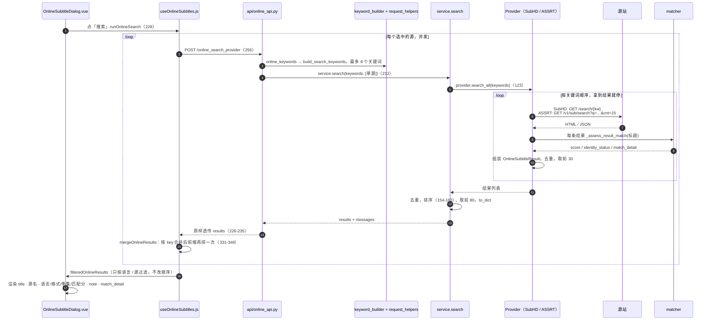

# 02 搜索链路与痛点①② · 海拉鲁字幕大师 V3（subtitlemanualupload）

> 任务：S2 P1-2-search-pain12 ｜ 编写：2026-10-15
> 参考仓提交：`8146218`（2026-08-28 01:50 AM，UTC+8）｜ 插件版本 1.2.7 ｜ GPL-3.0，只描述思路不复制代码
> 范围：在线搜索 → 候选列表 → 前端展示。后端 `online_subtitles/{service,models,shared,matcher,clients,keyword_builder,language}.py`、`providers/{base,subhd,assrt}.py`、`api/{online_api,routes,request_helpers}.py`；前端 `src/composables/useOnlineSubtitles.js`、`src/utils/onlineResult.js`、`src/components/OnlineSubtitleDialog.vue`。`language.py`、`request_helpers.py` 只读了各一个函数（约 15 行）
> 方法：按 `README.md`「研读规则」，先 Grep 后分段 Read；不联网，源站页面结构全部是「代码里的假设」，留待 P2 实测
> 出处写法：`文件:行号`，路径相对插件目录；「推测」= 由代码推断，「不确定」= 未能确认
> 痛点：①SubHD 结果不按下载量排序；②不显示制作组

---

## §0 一句话结论

- **①下载量**：从源站解析到前端，**每一层都没有这个字段**；排序全靠「源优先级 → 身份匹配 → 语言 → 标题相关性分数 → 标题」，最后一个打平键是**标题倒序**。所以即使 SubHD 页面本来就按下载量排，原来的顺序也会被打乱。归类：**没实现**，同时排序是**有意按相关性设计**的。
- **②制作组**：同样**每层都没有字段**。SubHD 解析时其实截了结果链接前后约 1,000 字符的页面文本，但**只拿去猜语言和格式**；`note` 填的是固定文案。ASSRT 也只读了标题、语言、格式相关的键。归类：**没实现**（页面上有没有、在哪里，**受源站限制，待 P2 确认**）。

---

## §1 链路时序图

前端是**按源各发一次请求**（`/online_search_provider`），后端每次只搜一个源，**跨源合并在前端完成**（`useOnlineSubtitles.js:253-283`）。另有一个汇总端点 `/online_search` 一次搜多个源（`api/online_api.py:130`），对话框没用它（推测，依据 `runOnlineSearch` 只调 `onlineSearchProvider`）。

关键词来源：`build_search_keywords`（`online_subtitles/keyword_builder.py:96-126`）用媒体标题和按地区挑出的多语种标题拼关键词。电影是「标题 年份」×最多 5 个，再加纯标题×5；剧集是「标题 SxxEyy」或「标题 Sxx」×最多 4 个。用户手输的关键词排第一，总数截到 8 个（`api/request_helpers.py:75-81`）。

---

## §2 证据链表 A：下载量

| 层 | 检查问题 | 结论 | 出处 文件:行号 |
|---|---|---|---|
| 1 源站解析（SubHD） | 抓的是什么页？ | 先抓**搜索列表页** `/search/{kw}`，解析失败才进**详情页** `/d/{douban_id}`（最多 4 个）。两个页面用的是**同一个解析函数** | `providers/subhd.py:89`、`117-135`、`167`；URL 构造 `providers/base.py:88-89` |
| 1 | 用什么选择器？ | 没用 HTML 解析器，用**正则**：只匹配 `<a href="/a/{sid}">标题</a>`，取 href、sid 和锚文本 | `providers/subhd.py:209-211` |
| 1 | 解析下载量了吗？ | **无**。只在链接前 700、后 300 字符的窗口里取页面文本，用途只有猜语言和格式；窗口里即使有下载数也没被提取 | `providers/subhd.py:220-222`、`232-234` |
| 1 | 结果有截断吗？ | 有：单个关键词去重后取**前 30**；`search_all` 按关键词顺序，**第一个有结果的关键词就直接返回**，后面的关键词不再搜 | `providers/subhd.py:116`、`136`、`45-48` |
| 1 源站解析（ASSRT） | 读了下载量类字段吗？ | **无**。API 每次只要 15 条（`cnt=15`）；只读 `id / native_name / title / videoname / filename / desc / lang / subtype` | `providers/assrt.py:59-69`、`73-108`、`261` |
| 2 数据模型 | `OnlineSubtitleResult` 有下载量字段吗？ | **无**。26 个字段里跟「好坏」沾边的只有 `score`（匹配分），没有下载量、评分、上传时间 | `online_subtitles/models.py:8-34` |
| 2 | `to_dict` 输出了吗？ | **无**（模型里没有，自然不会输出） | `online_subtitles/models.py:36-66` |
| 3 服务层·打分 | `score` 由什么组成？ | **只看标题文本**：别名命中 +34 / 搜索词命中 +18、IMDb/TMDB 证据 +40（SubHD、ASSRT 不传 attrs，拿不到这项）、年份一致 +18、季集 +22 / 季 +10、标题里有语言词 +6；Provider 再加固定值 SubHD +10、ASSRT +8 | `online_subtitles/matcher.py:281-371`；`providers/subhd.py:237`；`providers/assrt.py:111` |
| 3 服务层·排序 | 排序键是什么？ | `(源优先级, 身份, 语言, score, title)` 整体**倒序**。源优先级固定 SubHD 35 > ASSRT 30；身份 strong 30 / weak 10；语言 中 40 > 英 30 > 日韩 20 | `online_subtitles/service.py:154-163`；`matcher.py:56-75`；`language.py:81-89` |
| 3 | 能不能保留源站原顺序？ | **部分**：Python 排序是稳定的，但最后一个键 `item.title` 倒序参与比较，前四个键打平时会按**标题字典序倒排**，页面原顺序就丢了（推测：同一部影片的 SubHD 结果大多是 strong + 中文，score 也常常相同，打平很常见） | `online_subtitles/service.py:160` |
| 3 | 多源合并、去重、截断 | 后端：按 `(provider, result_id)` 去重，取**前 80**。因为前端按源分别请求，后端每次实际只排一个源 | `online_subtitles/service.py:153`、`165`；`shared.py:274-283` |
| 4 API | 返回里有下载量吗？ | **无**。`results` 原样透传 `service.search` 的结果，不加工 | `api/online_api.py:226-235`（汇总端点 `178`） |
| 5 前端·排序 | 前端有再排一次吗？ | **有**，而且键的顺序和后端**不一样**：源优先级 → 语言 → 身份 → score → 源名。没有下载量。前四个键打平时比较结果为 0，稳定排序保留后端的顺序（也就是标题倒序） | `src/composables/useOnlineSubtitles.js:331-346`；`src/utils/onlineResult.js:17-23`、`75-88` |
| 5 前端·渲染 | 显示了吗？可以手动排吗？ | **无**。卡片只显示标题、源名、`onlineResultMeta`（语言 · 格式 · SxxEyy · 匹配分）、note、match_detail；只有按语言、按源的过滤，没有排序控件 | `src/components/OnlineSubtitleDialog.vue:267-276`；`src/utils/onlineResult.js:25-34`；`useOnlineSubtitles.js:68-74` |

## §3 证据链表 B：制作组 / 发布人

| 层 | 检查问题 | 结论 | 出处 文件:行号 |
|---|---|---|---|
| 1 源站解析（SubHD） | 页面 URL、选择器同表 A | 同表 A：只有 `/a/{sid}` 链接的锚文本 | `providers/subhd.py:209-211` |
| 1 | 解析制作组/发布人了吗？ | **无**。周围窗口文本拿到了，但只送进 `_guess_language_label` / `_guess_subtitle_format`。如果 SubHD 的字幕标题里本身带组名（如 `[组名] 片名…`），会**顺带出现在 title 里**，但没有单独提取（推测，标题格式待 P2） | `providers/subhd.py:211`、`220-234` |
| 1 | `source` / `note` 填了什么？ | `source` = 站点显示名「SubHD」，`note` = 固定文案「通过 SubHD 自动搜索」，都**不是**制作组 | `providers/subhd.py:238-239` |
| 1 源站解析（ASSRT） | 读了制作组类字段吗？ | **无**。`note` 同样是固定文案「通过 ASSRT 官方 API 搜索」 | `providers/assrt.py:113`；读取的键见表 A |
| 2 数据模型 | 有字段吗？ | **无**。`source` 是站点名，`provider_label` 是源显示名，都不是制作组 | `online_subtitles/models.py:19`、`23`、`41` |
| 3 服务层 | 打分 / 排序用到了吗？ | **无**；去重键 `(provider, result_id)` 不涉及组名，所以不会把不同组的版本误合并 | `online_subtitles/service.py:154-163`；`shared.py:278` |
| 4 API | 返回里有吗？ | **无**（原样透传） | `api/online_api.py:226-235` |
| 5 前端 | 有渲染吗？ | **无**。界面上「看起来像来源」的只有 `providerName(item.provider)`（站点名）和 `note`（固定文案） | `src/components/OnlineSubtitleDialog.vue:269`、`275` |

---

## §4 ASSRT 附表：API 字段取用情况

| 字段 | 海拉鲁是否读取 | 用途 | 出处 |
|---|---|---|---|
| `id` | 是 | `result_id`、详情 URL、下载 | `providers/assrt.py:73`、`104-105` |
| `native_name` / `title` / `videoname` / `filename` | 是（按顺序取第一个非空的作标题） | `title`；也参与乱码检测 | `providers/assrt.py:260-265`、`77-81` |
| `desc`、`lang` | 是 | 只用来猜语言（`lang` 直接 `str()`，若是对象会把整个 dict 当文本用，推测无害） | `providers/assrt.py:86` |
| `subtype` | 是 | 猜格式 | `providers/assrt.py:108` |
| 下载量（如 `down_count`） | **否** | — | 搜索端点只请求 `/v1/sub/search`（`59-69`）；详情 `/v1/sub/detail` 只在下载时调用，且只读 `url / filename / filelist`（`140-153`） |
| 评分（如 `vote_score`） | **否** | — | 同上 |
| 发布 / 来源（如 `release_site`、`producer`） | **否** | — | 同上 |
| 上传时间（如 `upload_time`） | **否** | — | 同上（matcher 支持 `attrs.upload_date`，`matcher.py:328`，但 ASSRT 没传 attrs） |

> 「否」那几行的字段名是根据 ASSRT 公开 API 文档的**印象**写的，**不确定**：哪些字段在 search 里返回、哪些只在 detail 里返回，留 P2 实测。按海拉鲁的代码看，它从没碰过这些键。

---

## §5 根因结论

| 痛点 | 归类 | 理由 |
|---|---|---|
| ① 不按下载量排序 | **没实现**（主因） | 源站解析、数据模型、API、前端四层都没有下载量字段，从源头就没解析 |
| | **设计取舍**（叠加） | 排序目标是「这条字幕是不是这部片子」：源优先级 → 身份 → 语言 → 标题相关性分。`score` 只是**匹配分**不是质量分，前端还把它显示成「匹配 N」 |
| | **设计缺陷**（叠加，推测） | 最后一个打平键是标题倒序，会打乱源站原顺序；前后端两套排序键顺序不一致（后端 身份→语言，前端 语言→身份）。算不上 bug，但让「保留站点顺序」这条退路也失效了 |
| | **受源站限制**（待 P2） | 搜索列表页有没有下载数、是不是静态 HTML。抓取用的是 urllib 拿原始 HTML（`clients.py:75-88`），没有执行 JS；如果下载数是 JS 渲染的，这条路拿不到 |
| ② 不显示制作组 | **没实现**（主因） | 各层都没有字段；`note` 被固定文案占用。SubHD 解析其实拿到了周围文本，只差提取这一步 |
| | **受源站限制**（待 P2） | 制作组在列表页还是只在详情页，是独立元素还是混在标题里。只在详情页的话，每条多一次请求，和「低频访问」的约束冲突 |

**不是 bug 的部分**：没发现「解析了又丢掉」的情况。下载量和制作组都是**从来没进过数据流**。（S1 §7 #1 的疑问到此解答。）

---

## §6 对合璧字幕的启示

### 6.1 候选数据模型应有的字段（思路，P3 定稿）

对齐 `01-requirements.md` F4.1–F4.3：

| 类别 | 建议字段 | 说明 |
|---|---|---|
| 身份 | `provider`、`provider_item_id`、`detail_url`、`title` | 和海拉鲁一样，去重键用 `(provider, provider_item_id)` |
| **质量指标（原始值）** | `download_count: int \| None`、`rating: float \| None`、`upload_time: datetime \| None` | **用 `None` 表示「没拿到」，和 0 区分开**；SubHD 和 ASSRT 的下载量口径不同，不能直接跨源比较 |
| **来源** | `release_group`（制作组）、`uploader`（上传人）、`source_type`（官方 / 原创翻译 / 转载精修 / 机翻 / AI 校对） | 制作组和上传人分开存；`source_type` 可先按关键词推断，并标注是推断出来的 |
| 内容 | `languages`（集合，如 {简, 英}）、`is_bilingual`、`formats`、`release_version`（片源版本，如 WEB-DL / BluRay）、`packaging`（单文件 / 压缩包 / 季包） | 「必须含简中 + 外语」靠这几项判断；`packaging` 和痛点③有关 |
| 匹配 | `match_status`（strong / weak / failed）、`match_reasons`、`season` / `episode` | 海拉鲁的身份判定思路可以借鉴（年份冲突、季集不匹配直接排除） |
| 溯源 | `source_rank`（在源站结果页里的原始位置）、`query`（用哪个关键词搜到的）、`raw_extra: dict` | `source_rank` 让排序打平时可以退回到「站点顺序」；`raw_extra` 用来存源站特有的字段，免得频繁改模型 |

### 6.2 排序放在哪一层

1. **Provider 只解析、不打分**：只负责把源站的原始值填进模型，不加「SubHD +10」这类固定分。
2. **核心层统一排序**：放在和 MP 无关的核心逻辑里（符合 CLAUDE.md「核心逻辑与 MP 接口层分离」）。顺序建议：先按硬条件过滤（身份 failed 的剔除）→ 语言达标（简中 + 外语）→ 片源版本匹配 → 来源类型 → **下载量 / 评分**（每个源内部先归一化再跨源比较）→ 格式偏好 → `source_rank`。**不要用标题字典序打平**。
3. **排序键要明确、可解释**：每条候选带上排序依据（类似海拉鲁的 `match_detail`，再加质量指标），自动挑 2 份时写进日志。
4. **前端不再重排**：默认直接显示后端的顺序；F4.1 的「按下载量 / 评分 / 时间排序」做成用户切换的显示排序，**只改显示顺序，不改自动挑选的结果**。避免海拉鲁那种前后端各排一次、键还不一致的情况。
5. **固定的源优先级不放第一位**：海拉鲁让 SubHD 永远排在 ASSRT 前面，下载多的 ASSRT 字幕也排不上去。源优先级最多当一个弱权重。

### 6.3 其他可借鉴 / 应避免

- 借鉴：身份判定（标题别名、年份冲突、季集），`identity_status` 三档；按 `(provider, id)` 去重；单源失败不影响其他源（`service.py:122-150`）；前端按源并发请求、逐个合并，先返回的源先显示。
- 避免：`search_all`「第一个有结果的关键词就停」（`subhd.py:45-48`）。英文名搜到 3 条就不再试中文名，可能漏掉更好的版本，对下载量排序尤其不利；SubHD、ASSRT 都限频，权衡留给 P3。
- 避免：语言窗口取链接前 700 字符，可能把上一条结果的文字也算进来，导致语言误判（推测，取决于页面结构）。

---

## §7 待 P2 验证的问题

### 7.1 SubHD 页面结构假设清单（海拉鲁代码里的假设，全部**待实测**）

> 2026-10-16 已答 → `docs/api-notes/subhd.md` §2（#1–#7）、§3（#8–#11）：列表页就有下载量、发布人、字幕组、来源类型、上传时间，服务器直接给出；没有评分。

| # | 假设 | 用在哪里 | 出处 |
|---|---|---|---|
| 1 | 根地址 `https://subhd.tv` | 所有请求 | `online_subtitles/shared.py:28` |
| 2 | 搜索页 URL：`{root}/search/{关键词 URL 编码}`，GET，静态 HTML 可直接拿到结果 | 标题搜索；IMDb 号搜索也走这里（`/search/tt…`） | `providers/base.py:88-89`；`subhd.py:89`、`252` |
| 3 | 搜索页里，影片（条目）链接形如 `<a href="/d/{数字}">…</a>`，锚文本或 `img alt` 是片名 | 结果为空时进详情页的候选 | `subhd.py:142-148` |
| 4 | 详情页 URL：`{root}/d/{豆瓣 ID}`，**SubHD 条目 ID 就是豆瓣 ID** | 豆瓣 ID 直查、豆瓣兜底 | `subhd.py:55-71`、`167` |
| 5 | 字幕条目链接形如 `<a href="/a/{sid}">字幕标题</a>`（sid 由字母、数字、`_`、`-` 组成），**搜索页和详情页结构相同** | 唯一的字幕结果来源 | `subhd.py:209-211` |
| 6 | 语言、格式信息在字幕链接前 700 / 后 300 字符以内 | 猜语言和格式 | `subhd.py:220-222` |
| 7 | 字幕详情页 `/a/{sid}` 有 `href=".../down/{sid}"` 的下载按钮，或者带 `data-sid` 属性 | 下载（本项目只核实页面结构，验证码部分按 D004 不涉及） | `subhd.py:351-366` |
| 8 | **新增要查**：搜索列表页每条字幕旁有没有下载次数？在哪个元素里？是静态 HTML 还是 JS 渲染？ | 痛点① | — |
| 9 | **新增要查**：制作组 / 上传人在列表页还是只在详情页？是独立元素还是混在标题里？ | 痛点② | — |
| 10 | **新增要查**：列表页的默认顺序（时间？下载量？）；有没有排序参数或分页参数 | 是否可以直接用站点顺序 | — |
| 11 | **新增要查**：评分、上传时间、「官方 / 原创 / 转载」之类的标签在不在列表页 | F4.1–F4.2 | — |

### 7.2 ASSRT

| # | 问题 |
|---|---|
| 1 | `/v1/sub/search` 每条返回哪些字段？有没有下载量、评分、`release_site`、上传时间？（§4 的字段名是凭印象写的） |
| 2 | 下载量、制作组是不是只在 `/v1/sub/detail` 里？如果是，每条多调一次 detail，20 次/分钟的限额够不够 |
| 3 | `cnt` 最大能设多少；`pos` 分页怎么用 |
| 4 | `lang` 字段的结构（对象还是字符串），能不能直接判断「简中 + 英」双语 |

### 7.3 留给后续任务

- 自动链路（C 线）挑字幕用的是 `matching/subtitle_language.py:285 auto_subtitle_sort_key`，不是本文的在线排序。它有没有考虑下载量或制作组，交给 S4。
- 更正 S1：`01-module-map.md` §5① 写的「前端合并后再按 score 二次排序」不完整，前端完整的键是 源优先级 → 语言 → 身份 → score → 源名（本文 §2）。
