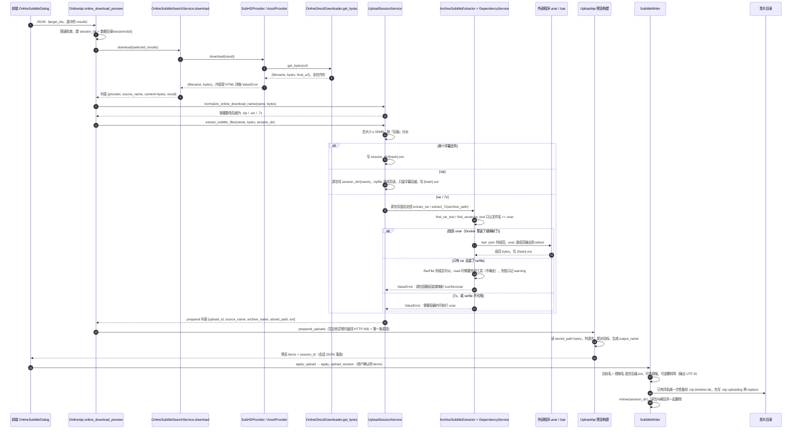

# 03 下载 → 解包 → 写入链路与痛点③ · 海拉鲁字幕大师 V3（subtitlemanualupload）

> 任务：S3 P1-3-archive-pain3 ｜ 编写：2026-10-15
> 参考仓提交：`8146218`（2026-08-28 01:50 AM，UTC+8）｜ 插件版本 1.2.7 ｜ GPL-3.0，只描述思路不复制代码
> 范围：`providers/{base,subhd,assrt}.py` 下载段、`online_subtitles/{service,clients}.py` 下载函数、`api/{online_api,upload_api}.py`、`upload/upload_session.py`（全部解包代码）、`matching/{subtitle_writer,subtitle_language,tongwen}.py`、`auto_transfer/{auto_transfer,auto_transfer_write,auto_transfer_season}.py` 相关段、`catalog/{target_resolver,target_normalizers}.py` 的集数配对、`config/config_schema.py` 与 `runtime/service_factories.py` 的解包装配、`__init__.py` 常量、`requirements.txt`
> 方法：按 `README.md`「研读规则」，先 Grep 后分段 Read。共读 20 个文件，超过规则约 15 个的上限；超出的 5 个都只读 15～90 行（用于确认工具名常量与集数配对）。**没有联网**：rarfile 的行为凭记忆，标「不确定」
> 出处写法：`文件:行号`，路径相对插件目录；「推测」= 由代码推断，「不确定」= 未能确认
> 用户给出的现象：报错（原文没记录），怀疑是因为没在 Docker 里运行、缺组件。所以 A/B/C 三种含义都查，A 为主

---

## §0 一句话结论

- **A 压缩格式（根因，已确认）**：zip 用标准库，Windows 下可用；**rar 和 7z 都绑死在一个叫 `unar` 的外部程序上**，判断条件是「文件名**恰好等于** `unar`」。Windows 下的可执行文件叫 `unar.exe`，所以**即使装了也认不出来**。依赖准备的三种模式（none / container_install / mapped_binary）都是为 Docker 设计的。7z **没有任何**替代路径；rar 还有一条 `rarfile` 兜底，但 rarfile 自己解压时同样需要外部工具（不确定，据记忆），所以在 Windows 原生环境下，rar 和 7z 包**必然**报「请在容器安装或映射 /usr/bin/unar」。
- **B 包内多文件（不报错，但会挑错 / 丢东西）**：解包时**目录结构被拍平**；包里再套的压缩包被**静默跳过**；zip 里 GBK 编码的文件名**没做 cp437 回转**，会变乱码；语言判定有三处明显缺陷（纯中文 ASS 会被判成中英双语、Big5 分支永远走不到、简繁只看文件名）；在线下载**不转码**，原样写入。
- **C 剧集合集**：只按**文件名**（不看目录）匹配 `SxxEyy`、`第N集` 等模式来配对；解出的整季字幕按「影片+季」缓存，后面入库的集直接复用；**字幕文件上限 100 个**，大季包会被整包拒绝。

---

## §1 链路时序图（在线下载 A 线；手动上传 B 线从第 11 步起完全相同）

每步的输入与输出：

| 步 | 输入 | 输出形态 | 出处 |
|---|---|---|---|
| 5-7 下载 | URL | **内存 bytes** + 文件名（来自 Content-Disposition，或取 URL 末段，兜底 `subtitle.zip`）；SubHD 兜底名 `subhd-{sid}.zip` | `clients.py:185-231`；`providers/subhd.py:344-420`；`providers/base.py:40-46` |
| 8 汇总 | — | 字典列表，`content` 字段仍是 bytes | `online_subtitles/service.py:169-188` |
| 9-10 规范化文件名 | 文件名 + bytes | 文件名（魔数优先：PK / `Rar!` / `7z\xbc\xaf`）| `upload/upload_session.py:120-128`、`696-726` |
| 11-12 解包入口 | 文件名 + bytes + session_dir | 先把**原包写成临时文件** `session_dir/{原名}`，再按后缀分派 | `upload/upload_session.py:779-823` |
| 13-21 各分支 | 原包路径 | 每个字幕成员写成 `session_dir/{hash}{ext}`，返回 `prepared` 字典列表 | 同上 `431-485`、`562-600`、`825-856` |
| 23-24 预览 | prepared 列表 | 预览 items（语言后缀、目标、输出名）+ 会话 JSON | `api/upload_api.py:29-106` |
| 25-27 写入 | session_id + items | 影片目录里的字幕文件；session_dir 被删除 | `matching/subtitle_writer.py:226-370`、`372-436`（rmtree 在 412 行） |

自动链路（C 线）调用的也是同一个 `extract_subtitle_files`（`auto_transfer/auto_transfer.py:215-216`，通过 callback 拿到），之后由 `auto_transfer_write.py:70-112` 的 `select_subtitle_items` 自动挑选，不经过预览。

---

## §2 证据链表 A：压缩格式

| 层 | 检查问题 | 结论 | 出处 文件:行号 |
|---|---|---|---|
| 1 下载 | 不同格式在下载层有区别吗？ | **无**。都是整包 bytes 留在内存里；只拒绝 HTML。日志里的 `_content_magic` 只认 zip / rar，不认 7z，但它只用于日志 | `clients.py:185-231`、`234-245` |
| 2 文件名 | 后缀是怎么确定的？ | 在线下载：**魔数优先**，能纠正伪造或缺失的后缀。手动上传：**只信文件名后缀**（不调用规范化）→ 例如一个 rar 包被命名成 `.zip`，会报「压缩包损坏」 | `upload/upload_session.py:696-726`；`api/upload_api.py:157-163`；`upload/upload_session.py:855` |
| 3 分派 | 支持哪些格式？ | `_archive_exts = {.zip, .rar, .7z}`；`.tar`、`.gz` 等返回空列表，被计入「不支持」 | `__init__.py:267-272`；`upload/upload_session.py:805-806` |
| 4 zip | 依赖什么？Windows 能用吗？ | 标准库 `zipfile`，**Windows 能用** ✔ | `upload/upload_session.py:9`、`825-856` |
| 5 rar·找工具 | 怎么找外部程序？ | `find_rar_tool` 依次看配置路径（默认 `/usr/bin/unar`）和 `shutil.which("unar")`，但**只接受文件名恰好是 `unar` 的程序**：`return candidate.name.lower() == "unar" and is_executable_file(candidate)`。Windows 上 which 返回的是 `...\unar.EXE`，名字对不上 → **永远找不到** | `upload/upload_session.py:136-160`；`config/config_schema.py:22`；`__init__.py:271` |
| 5 rar·列表 / 读取 | 用什么命令？ | `lsar -json` 列成员（lsar 要和 unar 在同一目录，或在 PATH 里），然后**每个成员调一次** `unar ... -output-directory -` 输出到 stdout。7-Zip、UnRAR 一律不支持 | `upload/upload_session.py:389-428` |
| 5 rar·rarfile 兜底 | Python 包能顶上吗？ | 顺序是：unar → rarfile → 报错。rarfile 能列出成员，但读取压缩过的成员时，要调用外部的 unrar / unar / 7z / bsdtar 之一（**不确定，据记忆**）。读取失败的异常被降级成 warning，然后抛出「已声明 Python 依赖 rarfile，但 RAR 内容解压仍需要外部解压程序；请在容器安装或映射 /usr/bin/unar」 | `upload/upload_session.py:487-538`；`requirements.txt:1` |
| 5 rar·意外通路 | Windows 有没有能用的情况？ | 推测：如果 Windows 的 PATH 里有 rarfile 能识别的工具（比如 UnRAR.exe），rarfile 这条路**可能成功**，因为 rarfile 找工具不经过海拉鲁的 `unar` 名字检查（**不确定**，P2 验证） | 同上 |
| 6 7z | 依赖什么？ | **没有 py7zr，也不用 7z.exe**：`find_sevenzip_tool` 和 rar 的逻辑完全一样，只认 `unar`；`_sevenzip_tools = ("unar", "/usr/bin/unar")`。名字叫 sevenzip，实际仍是 unar → Windows 下**一定失败**：「7z 压缩包解压需要容器内可执行 unar…」 | `upload/upload_session.py:174-189`、`541-559`；`__init__.py:272` |
| 7 依赖准备 | 能自动装吗？ | 三种模式：`none`（**默认**，只检测）、`container_install`（`sh -lc` + `apt-get install unar`）、`mapped_binary`（宿主机 unar 挂载进容器）。后两种都假定是 Linux 容器，**Windows 原生一个都用不上** | `upload/upload_session.py:233-306`；`config/config_schema.py:27`、`136-140`；`__init__.py:174`、`316` |
| 8 报错如何呈现 | 用户看到什么？ | `ValueError` → 记入 `invalid_files`；一个字幕都没解出来时返回 HTTP 400：「没有解析到可用字幕文件，{第一条原因}」 | `api/online_api.py:46-57`、`293-297`；`api/upload_api.py:162-195` |

**A 结论**：失败发生在**第 5、6 层（找工具）**，触发条件是「运行环境里没有一个文件名恰好为 `unar` 的可执行文件」。这个设计只在 Linux 下成立，Docker 用户靠 `container_install` / `mapped_binary` 补齐。和你的判断一致，而且更严重一些：**在 Windows 原生环境下装了 unar 也没用**。

---

## §3 证据链表 B：包内多文件

| 层 | 检查问题 | 结论 | 出处 文件:行号 |
|---|---|---|---|
| 1 收哪些成员 | 多个字幕全都要吗？ | 只要后缀属于 `.ass .srt .ssa .sbv .sub .vtt .webvtt` 的成员**全部收下**（不去重）；`.idx`、`.sup`、`.txt`、`.nfo` 等**静默丢弃** | `__init__.py:267`；`upload/upload_session.py:834-837` |
| 1 | 有上限吗？ | 成员 ≤512 个，单个 ≤20MB，字幕 ≤100 个，解压后合计 ≤80MB；任意一项超限，**整个包作废**（`ArchiveResourceLimitError`） | `upload/upload_session.py:26-30`、`77-117` |
| 2 嵌套目录 | 目录信息保留吗？ | **不保留，拍平**：只取最后一段文件名（zip 用 `Path(...).name`，rar/7z 按 `\` 或 `/` 切分）。目录名里的语言（如 `简体/`）、集数（如 `S01E03/`）信息全部丢失；不同目录里的同名文件 hash 不同，写盘不冲突，但 `source_name` 会重复 | `upload/upload_session.py:832`、`455`、`580` |
| 3 嵌套压缩包 | 包里的 zip / rar 会继续解吗？ | **不会**。内层压缩包的后缀不在字幕后缀集合里，被**静默跳过**；如果整个包里只有内层压缩包，结果为空 → 「没有解析到可用的在线字幕文件」 | `upload/upload_session.py:834-837`；`api/online_api.py:55-57`、`297` |
| 4 zip 内 GBK 文件名 | 乱码处理了吗？ | **没有**。全仓 Grep 不到 `cp437`、`0x800`、`metadata_encoding`。zipfile 对没有 UTF-8 标志位的成员名按 cp437 解码 → 中文名变成乱码 → 下面第 5 层的文件名语言识别失效，只能退回按内容判断。写入时的文件名用的是视频名，所以**不影响落盘文件名** | Grep 结果；`upload/upload_session.py:832` |
| 5 语言判定 | 怎么判断简 / 繁 / 英 / 双语？ | 两段式：① **文件名**里的 ASCII 词元（`chs`、`cht`、`eng`、`zh-tw` 等别名，`&+/,` 表示组合）；中文词元在清洗时就被删掉了，不参与这一步。② 文件名判不出时看**内容**：解码前 16,000 字节，统计汉字 / 假名 / 谚文 / 3 个以上字母的英文单词数量（各 ≥20），并在**完整文件名**里查 `简体`、`繁体`、`中英` 等中文关键词 | `matching/subtitle_language.py:90-137`、`140-227` |
| 5 | 缺陷 ①：纯中文 ASS | ASS 文件头里的 `Style`、`Dialogue`、`Default`、字体名等很容易凑满 20 个英文单词，最后一条规则「中文且有英文单词 → `chi&eng`」会把**纯中文 ASS 判成中英双语**（推测，置信度高，P2 用样本验证） | `matching/subtitle_language.py:150`、`177`、`220-222` |
| 5 | 缺陷 ②：简繁 | 内容层面**不区分简繁**，`cht` 只来自文件名关键词。文件名乱码或者没有标注时，繁体会被当成简体 | 同上 `180-188` |
| 5 | 缺陷 ③：解码顺序 | 顺序是 utf-8-sig → **utf-16** → gb18030 → big5。Big5 的双字节编码范围落在 GB18030 的合法范围内，所以 **big5 这一项永远轮不到**，Big5 文件会被当成 gb18030 解成「乱码汉字」（推测，置信度高）；没有 BOM 时先试 utf-16，可能把 GBK 内容误解码（推测，置信度中） | `matching/subtitle_language.py:62-70` |
| 6 挑选（自动） | 多个候选怎么排？ | 排序键依次为：语言档（默认 双语 > 简 > 繁 > 英；「双语」档把中英、中日、繁英都算在内）→ 格式（.ass > .srt > .ssa > .vtt）→ 是否双语 → 文件名字母序。模式 `best` 只取第 1 个，`chinese_all` 取所有中文，`all` 全取；最后按「目标输出名」去重，保留先出现的 | `matching/subtitle_language.py:8-9`、`272-304`；`auto_transfer/auto_transfer_write.py:70-112` |
| 6 挑选（手动 / 在线） | 怎么挑？ | 不自动挑：预览**列出全部**字幕及建议目标和输出名，由用户确认后写入（推测：前端可以取消勾选，未读前端） | `api/upload_api.py:47-66` |
| 7 挑不出来 | 怎么兜底？ | 自动：没配上目标的条目被丢掉；全部丢光时状态为 `skipped`，原因「整季包未能匹配到当前入库集数」。手动：两个条目算出**同一个输出名**（例如两个都被判成 `chi&eng.ass`）时**直接报 400** 「重复映射到同一个目标字幕名」，要用户自己改 | `auto_transfer/auto_transfer_write.py:132-140`；`matching/subtitle_writer.py:77-79` |

**B 结论**：「多文件包」**不会导致报错**，但会出现两类问题：挑选**静默出错**（判错语言、拍平目录后丢失信息、内层压缩包被跳过）；手动模式下同名冲突**直接报 400**。

---

## §4 证据链表 C：剧集合集包（只记做法）

| 环节 | 做法 | 出处 |
|---|---|---|
| 集数提示 | 只看**拍平后的文件名**，用正则匹配：`SxxEyy`、`NxM`、`第N季…第M集`、`第M集`。**不支持** `EP01`、单独的 `E01`、`[01]`、` - 01 `（动画常见） | `catalog/target_normalizers.py:77-98` |
| 单目标（电影） | 只有 1 个目标时，**所有字幕都归它**，除非文件名里的季 / 集和目标冲突 | `catalog/target_resolver.py:327-353` |
| 多目标 | 季 + 集精确匹配；字幕没写季号且目标只有一季时，只按集号匹配 | 同上 `355-370` |
| 兜底 | 只有在「没有任何集数提示」且剩余条目数与剩余目标数**相等**时，才按顺序一一分配；有提示但没配上的**绝不**按位置硬塞（代码注释说明了原因：防止把旧缓存写到新的一集） | 同上 `373-406` |
| 季包缓存 | 解出的字幕（**不是原包**）复制到 `数据目录/auto_season_packages/{hash(影片|sNN)}/`，另写一份 `manifest.json`；内存里按 LRU 保留 50 个。后续入库的集直接从缓存写，不再下载 | `auto_transfer/auto_transfer_season.py:40-126` |
| 上限 | 字幕 ≤100 个：比如 20 集 × 简 / 繁 / 英 / 双语 × ass / srt = 160 个，**整包作废**（推测会发生，取决于实际包的大小） | `upload/upload_session.py:30` |

---

## §5 手动上传 vs 在线下载

| 对比项 | 手动上传 `prepare_upload` | 在线下载 `online_download_preview` | 是否关键 |
|---|---|---|---|
| 解包入口 | `extract_subtitle_files` | **同一个** | — |
| 文件名 / 后缀 | 用浏览器上传时的原名 | 先按魔数规范化 | 次要：手动上传遇到后缀错误会失败 |
| 依赖检查 | 同一个 `ArchiveDependencyService` | 同 | — |
| 失败呈现 | 400 + 第一条原因 | 同 | — |

出处：`api/upload_api.py:108-202`、`api/online_api.py:26-63`、`237-313`。

**结论**：两条线**没有本质差异**，所以不可能出现「手动上传能处理而在线下载不能」的情况。rar / 7z 在两条线上**同样失败**，痛点③与入口无关。

---

## §6 写入命名、覆盖、编码与繁转简（供 F6.6 参考）

| 项 | 海拉鲁的做法 | 出处 |
|---|---|---|
| 文件名 | `{视频 basename}.{语言后缀}{ext}`，例如 `Movie.2024.chi&eng.ass`、`Movie.cht.srt`；后缀会规范化成 `chi / cht / eng / jpn / kor / fre…`，组合用 `&` 连接 | `matching/subtitle_writer.py:17-29`；`subtitle_language.py:73-87` |
| 同名冲突 | 同一个目标「语言后缀 + 扩展名」只能有一份：手动报 400，自动去重保留第一份 → **无法同时放两份 `chi&eng.ass`**（和我们 F6.1 的「2 份双语」直接冲突） | `subtitle_writer.py:77-79`；`auto_transfer_write.py:101-110` |
| 覆盖 | **会覆盖**同名字幕；覆盖前一次性备份为 `{原名}.mp-timeline-bk`（备份已存在就不再更新，所以保留的是最早那份）；写入时先写 `.mp-uploading` 再 `replace`，属于原子替换 | `subtitle_writer.py:137-147`、`320-329` |
| 编码转 UTF-8 | **写入时不转码**：`shutil.copyfile` 原样复制字节，GBK 的字幕仍以 GBK 落盘。只有开启繁转简、并且语言后缀是中文时，才顺带以 UTF-8 重写 | `subtitle_writer.py:328`、`198-224` |
| 繁转简 | 在**写入阶段、调轴之后**进行：`maybe_convert_operation_to_simplified` → tongwen 词组表 + 单字表；解码顺序与语言判定相同（Big5 同样会先被 gb18030「成功」解码 → 推测会把**乱码再做一次简体转换**后以 UTF-8 写出） | `subtitle_writer.py:198-224`、`318`；`matching/tongwen.py:29-55` |
| 语言判定时的解码 | 只为了预览判断语言，不改动文件 | `subtitle_language.py:62-70`、`147` |
| 原包保留 | **不保留**：原包只是 session_dir 里的临时文件，写入后 `rmtree`；不写入时保留 24 小时，之后清理；预览失败立即删除 | `subtitle_writer.py:412`（apply 内）；`__init__.py:295`；`upload_session.py:766-777`；`api/online_api.py:278-297` |

---

## §7 根因

| # | 痛点③ 的含义 | 根因 | 类型 | 置信度 |
|---|---|---|---|---|
| 1 | rar / 7z 报错 | 外部解包工具**只认名字恰好为 `unar` 的可执行文件**，默认路径是 Linux 的 `/usr/bin/unar`，自动安装依赖 `sh` + `apt-get`；7z 没有任何替代实现 | **平台假设**（为 Docker / Linux 设计） | 高（代码已确认）；rarfile 那条兜底路径的细节**不确定** |
| 2 | 多文件包挑错或丢文件 | 拍平目录、跳过内层压缩包、GBK 文件名不处理、语言判定有缺陷 | **没实现 / 启发式粗糙** | 中高（缺陷 ①③ 需要样本验证） |
| 3 | 大季包整包失败 | 字幕数量上限 100 个是针对整个包的 | **防护阈值** | 中（取决于实际包的大小） |

你遇到的「报错」最可能对应 #1，提示文字应该是下面两条之一（推测）：
- rar：「没有解析到可用字幕文件，已声明 Python 依赖 rarfile，但 RAR 内容解压仍需要外部解压程序；请在容器安装或映射 /usr/bin/unar」
- 7z：「没有解析到可用字幕文件，7z 压缩包解压需要容器内可执行 unar，或映射宿主机 unar 到容器 /usr/bin/unar」

---

## §8 对合璧字幕的启示（思路，P3 定稿）

### 8.1 解包模块的设计
1. **核心与 MP 分离**：设计一个纯 Python 的 `archive` 模块，输入原包路径，输出「解包清单」（每项包含**包内相对路径**、大小、原始文件名字节、解码后的文件名），再加一个「解包目录」。它不依赖 MP，可以直接在 `tests/` 里跑样本。
2. **用魔数判断格式**，不信后缀（海拉鲁只在在线下载这条线上做了，手动上传没做）。
3. **完整解包到存档目录，并保留目录结构**：既满足你说的「保留解压原文件」（F6.2 / F6.7），又让挑选环节能用上目录名里的语言和集数信息。挑选只读存档，写入时**复制**到影片目录。
4. **嵌套压缩包递归解包**，深度上限设为 2，所有层级共用一个资源计数器。
5. **防护阈值可以借鉴**（成员数、单文件大小、总大小、防路径穿越）。字幕数量的上限改成可配置，或者剧集模式下放宽。
6. **先列清单、做防护检查，再一次性解包**；不要学海拉鲁每个成员起一个子进程。
7. **依赖状态展示在界面上**（海拉鲁的 `dependency_status` 思路值得借鉴）：启动时检测，告诉用户「rar：可用 / 缺少 7-Zip，安装方法……」。

### 8.2 依赖选型（Windows 原生）
| 格式 | 方案 | 说明 |
|---|---|---|
| zip | 标准库 `zipfile` | 成员没有 UTF-8 标志位（0x800）时，把名字按 cp437 编回字节，再依次试 utf-8 → gb18030 → big5（按「解出来的名字像不像正常文本」来选）；Python 3.11+ 的 `metadata_encoding` 只能对整个包统一指定编码，不够灵活 |
| 7z | 首选外部 `7z.exe`；备选 `py7zr` | py7zr 是纯 Python 的，但依赖几个带 C 扩展的包，**Python 3.14 + Windows 上有没有现成 wheel 不确定**（P2 验证） |
| rar | **必须用外部程序**（目前没有成熟的纯 Python RAR 解压库） | 推荐 **7-Zip**：一个程序同时支持 zip / rar / rar5 / 7z，在 Windows 上很常见。其次是 UnRAR.exe。Windows 10 自带的 `tar.exe`（bsdtar / libarchive）可以零安装，但它对 RAR5 / 7z 的支持取决于 libarchive 版本（**不确定**，P2 验证）。rarfile 本身也是去调用这些工具，价值有限，可以不引入 |
| 工具探测 | 按候选清单查找 | 依次查：配置路径 → `shutil.which` 查 `7z / 7za / 7zz / unrar / tar` → Windows 常见安装位置（如 `C:\Program Files\7-Zip\7z.exe`；**7-Zip 安装程序默认不加 PATH**）。**不要比较具体文件名**，而是实际运行一次版本命令来确认可用 |

### 8.3 挑选、转码与命名
1. **先统一转码，再判断语言**：用 BOM → utf-8 严格解码 → 中文编码检测（区分 gb18030 和 big5 不能靠「解码成不成功」，要看解出的字是不是常用字，可以考虑 charset 检测库，MP 是否自带**不确定**）。**所有输出统一写成 UTF-8**（海拉鲁不转码）。
2. **按内容判断语言**时，ASS 要去掉文件头和样式标签、只看对话正文；简繁按「繁简不同的字」的出现比例来判断（tongwen 那类字表的思路），不依赖文件名。
3. **挑选目标**：「简中 + 外语」双语优先，选 2 份；没有双语时，用「简中单语 + 外语单语」合成（F6.3）；判断不出时转人工（F5.2）。
4. **命名**：海拉鲁「每种语言 + 扩展名只能有一份」的规则不能满足 2 份双语。我们需要一个区分段（比如来源或制作组），而且语言标记要能被 Jellyfin 识别（`chi&eng`、`cht` 不是标准代码，Jellyfin 能不能识别**不确定**）→ 等 P2 实测 Jellyfin 后定 F6.6。
5. **不覆盖**（F6.5）：同名文件已存在就换名或跳过，不学「覆盖 + 备份」；**原子写入（先写临时文件再 replace）可以借鉴**。

### 8.4 剧集（C）：与电影走同一条流水线
解包存档 → 统一转码 → 判断语言 → **按集配对** → 每集按电影规则挑 2 份 → 改成「该集视频名.标记.ext」写到该集视频旁。配对规则：
- 用**包内相对路径**（目录名 + 文件名）提取集数，正则要补上 `EP01`、`E01`、`[01]`、` - 01 `。
- 只有明确匹配才分配；配不上的进入人工列表。借鉴海拉鲁「有提示但没配上就不按位置硬塞」的原则。
- 季包和原包**每季只存一份**（借鉴「季包缓存」的思路），后续入库的集直接复用。

---

## §9 待 P2 验证的问题

| # | 问题 | 怎么验证 |
|---|---|---|
| 1 | 你当时看到的报错原文是否就是 §7 列出的那两条 | 在 MP 日志里搜「unar」「rarfile」（需要你同意后只读查看） |
| 2 | rarfile 读取压缩成员时是否一定需要外部工具；在 Windows 上它会找哪些工具名 | 读 rarfile 文档 / 源码，或在 `tests/` 里用样本实测 |
| 3 | MP 的 Python 3.14.7 环境里是否已经装了 rarfile、py7zr、charset 检测库 | 只读查看 MP 的 site-packages（需要你同意） |
| 4 | 本机 `tar.exe` 的 libarchive 版本；能否解 RAR5、7z、带中文文件名的包 | `tar --version` + 样本 |
| 5 | py7zr 及其依赖在 Python 3.14 + Windows 上有没有 wheel | 在隔离的虚拟环境里试装 |
| 6 | 7-Zip 默认安装后 MP 进程能否找到（PATH / 固定路径） | 本机检查 |
| 7 | 真实字幕包的分布：zip / rar / 7z 各占多少，GBK 文件名、嵌套目录、嵌套压缩包、双语形式各有多常见 | 从 SubHD / ASSRT 低频下载 10～20 个样本，放进 `tests/fixtures/` |
| 8 | 纯中文 ASS 会不会被判成双语，Big5 会不会被误解码，无 BOM 时 utf-16 会不会误解码 | 用样本写单元测试（测我们自己的实现，不运行海拉鲁） |
| 9 | Jellyfin 对 `chi&eng`、`cht`、`zh-CN`、`chs` 以及标题段的识别方式；GBK 字幕能否正常显示 | Jellyfin 实测（关联 F6.6） |
| 10 | 典型季包的字幕数量是否超过 100 个 | 样本统计 |
