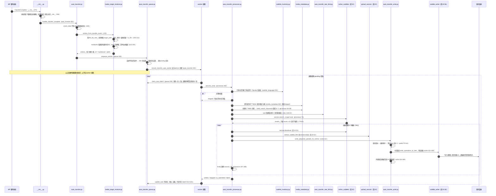

# 04 自动链路：整理完成 → 落盘 · 海拉鲁字幕大师 V3（subtitlemanualupload）

> 任务：S4 P1-4-auto-chain ｜ 编写：2026-10-15
> 参考仓提交：`8146218`（2026-08-28 01:50 AM，UTC+8）｜ 插件版本 1.2.7 ｜ GPL-3.0，只描述思路不复制代码
> 范围：`__init__.py`（事件订阅、服务注册）；`auto_transfer/` 除 `auto_transfer_season.py` 外全部（剧集只 Grep 入口）；`catalog/{media_target_resolver,target_resolver,media_metadata,subtitle_inventory}.py`；`matching/subtitle_history.py`；`runtime/{service_factories,service_registry,transfer_history_reader}.py`。搜索段引用 02，下载 / 解包 / 命名引用 03，不重读
> 方法：按 `README.md`「研读规则」，先 Grep 后分段 Read。范围内 15 个文件；范围外只用 Grep 加小段读取确认了 5 处：`catalog/target_normalizers.py`（`event_value`、`is_local_video_path`、`entry_filesystem_signature`，约 20 行）、`config/config_runtime.py:74-108`（`reset_runtime_state`）、`matching/subtitle_language.py:230-269`（中文字幕判定）、`runtime/shell_helpers.py:43-54`（委托实现）、`matching/subtitle_writer.py`（只看了 Grep 命中行）
> 出处写法：`文件:行号`，路径相对插件目录；「推测」= 由代码推断，「不确定」= 未能确认
> 对照：`docs/api-notes/mp-v3-plugin.md` §3（TransferComplete 字段）

---

## §0 一句话结论

- **入口很薄**：事件线程里只做三件事：解析 `event_data` 得到条目、合并到索引、放进内存队列；重活交给后台 daemon 线程。影片位置**只看 `transferinfo.file_list_new`**，宿主提供的 `target_item`、`idempotency_key`、`transfer_history_id` 都**没有用到**。
- **识别**：用事件里的 `mediainfo` / `meta`，再从文件名补集数，最后用 MP 的 TmdbChain 拿 TMDb 详情补别名。**不读 NFO，不用 IMDb**。挑结果只设一道「匹配分 ≥ 20」的门槛，然后按 02 的排序**依次试前 5 个**，第一个写成功就停。**下载量从头到尾没参与**。
- **幂等靠三层**：300 秒内存去重、活跃任务去重、「已有中文字幕就跳过」的天然幂等。队列、去重表、任务结果**全在内存里**，重启或热重载后就没了。
- **落盘只写中文字幕**（外语字幕转给 AI 翻译插件），文件名是 `视频名.语言后缀.ext`。所谓「匹配历史」**不是日志**，而是**扫描磁盘得到的快照**。失败信息只留在内存任务表（最多 200 条）和日志里。

---

## §1 端到端时序图

`auto_transfer:` = `auto_transfer/auto_transfer.py`；`queue:` / `processor:` / `write:` / `rate_limit:` 分别是 `auto_transfer/` 下对应文件；`batch:` = `auto_transfer.py:493 process_transfer_auto_task_batch`。

---

## §2 各步要点表

| 步 | 做法 | 出处 | 置信度 |
|---|---|---|---|
| 0 装配 | `services` 懒加载注册表，但注册表的每个访问器**每次调用都新建一个服务实例**（工厂不缓存）；`owner._xxx` 委托方法也是每次 `services.xxx()` 后再调方法。所以自动链路的全部状态都放在**插件实例属性**上，服务对象本身是无状态的「视图」 | `__init__.py:367-373`；`runtime/service_registry.py:37-53`；`runtime/service_factories.py:186-203`；`runtime/shell_helpers.py:43-54` | 高 |
| 0 | 构造 `AutoTransferService` 时，会把队列、限速器、处理器、季包缓存、写入策略**全部用 lambda 回调接好**（约 15 个协作者） | `auto_transfer.py:19-88`、`108-188` | 高 |
| 1 订阅 | 类方法上挂 `@eventmanager.register(EventType.TransferComplete)`；检查 `get_state()` 和 `_auto_search_on_transfer`（**默认 False**）后委托出去 | `__init__.py:379-383`、`206` | 高 |
| 2 解析事件 | 见 2a 字段表。外层要求 `event_data` 是 dict，内层三个对象用 `event_value` 兼容 dict 和属性两种形态 | `auto_transfer.py:304-307`；`target_normalizers.py:128-134` | 高 |
| 3 目标定位 | 从 `file_list_new` 取路径（单个字符串也接受），为空再取 `target_path`；每条路径都要满足「存储是 local + 后缀在 MP 的 `RMT_MEDIAEXT` 或 `.strm` 里 + `is_file()`」。条目的 `id = hash("local|" + path)`，storage 写死为 local | `media_target_resolver.py:200-213`、`267`、`286`；`target_normalizers.py:100-125` | 高 |
| 4 入队与去重 | 先过滤掉已经不存在的文件，然后经过两层去重：①`_transfer_auto_recent`：键是 `hash(路径小写 + 文件系统签名)`，300 秒内重复就跳过；②已有同 `entry_key` 的 pending / in_progress 任务时跳过。之后建 pending 任务，任务表只保留最近 200 条 | `auto_transfer_queue.py:46-75`、`109-144`、`93-107`；`__init__.py:186-187` | 高 |
| 5 worker | 单个 daemon 线程循环 `claim_next_batch`：电影每次取 1 条；剧集按「媒体 + 季」聚合，最后一条入队 3 秒后才处理（防抖）。没有 pending 任务时线程退出，下次入队再启动 | `auto_transfer.py:319-333`、`359-377`；`auto_transfer_queue.py:208-244` | 高 |
| 6 已有字幕 | 见 2b Q4 | `auto_transfer_processor.py:296-302` | 高 |
| 7 华语片跳过 | 开关 `_auto_skip_chinese_media_on_transfer` 默认开启：依次看分类正则（华语、国产、港台…）→ TMDb `original_language` → `origin_country` / `production_countries`，命中就跳过 | `media_metadata.py:250-305`；`__init__.py:207`、`293` | 高 |
| 8 识别与关键词 | 见 2b Q2 | `auto_transfer_processor.py:45-49` | 高 |
| 9 限速 | 每个源一个 60 秒滑动窗口，默认 **5 次 / 分钟**；**一次 `search` 调用只记 1 次**，不管它内部发了几个 HTTP 请求，下载请求也不计数。等待期间把任务消息改成「等待字幕源限速窗口」 | `auto_transfer_rate_limit.py:14-36`、`77-91`；`__init__.py:184` | 高（计数口径：推测会低估真实请求数，见 §3 避免 #4） |
| 10 筛选候选 | 只保留 `downloadable` 不为 False 且 `score ≥ _auto_search_min_score`（默认 20）的结果；**顺序就是 02 里服务层的排序**（源优先级 → 身份 → 语言 → 匹配分 → 标题倒序），没有下载量 | `auto_transfer_processor.py:79-91`；`__init__.py:209`；02 §2 | 高 |
| 11 下载与解包 | 前 5 个候选依次「下载 → 规范化文件名 → 解包到 `sessions/{id}`」；解包抛 ValueError 或解不出字幕就试下一个 | `auto_transfer_processor.py:94-140`；03 §1 | 高 |
| 12 挑选 | 用解出的字幕判断语言并配对目标，按 语言档 → 格式 → 是否双语 → 文件名 排序；模式 `best`（默认）每个目标只取 1 个 | `auto_transfer_write.py:42-112`；03 §3 第 6 层 | 高 |
| 13 写入 | 只有**中文**条目落盘：`write_operations_to_disk(fix_timeline=True)` 会先自动调轴，调轴结果低可信时**拒绝写入**（以 failed「低可信」结束，可以强制重试）；写完后清掉该目录的字幕缓存和匹配历史缓存 | `auto_transfer_write.py:146-159`；`subtitle_writer.py:291-305`、`352-369`（Grep 命中行） | 高 |
| 14 AI 兜底 | 外语条目交给 AutoSub 插件翻译；默认策略 `online_then_ai_source`：搜索没写成，也会整体转交 AI | `auto_transfer_write.py:163-180`；`auto_transfer_processor.py:314-329`；`__init__.py:208` | 高 |
| 15 状态 | 结果状态归并为 completed / skipped / failed，连同消息和结果字典写回内存任务表；批处理整体抛异常时，这一批全部标为 failed | `auto_transfer.py:513-533`、`368-377` | 高 |
| 16 历史 | 见 2b Q5 | `subtitle_history.py` | 高 |
| 17 剧集 | 同季的多集合并成一批，交给季包缓存（`process_group`）：先查缓存，没有就按季搜一次，整季包解出的字幕缓存起来，后面入库的集直接复用（细节见 03 §4） | `auto_transfer.py:497-503`；`auto_transfer_season.py:40`、`128`、`151`、`267` | 中（未 Read 正文） |
| 附 历史补偿 | `transfer_history_reader.py` 只是带数据库会话的 `TransferHistory.list_by_page` 只读分页查询，被 `local_media_catalog` 用来建本地媒体索引（`build_entry_from_history`，读 `dest_fileitem` / `dest`）。**自动链路不使用它**，也**没有**「漏掉的事件从整理历史补回来」的机制（01 §7 #7 答案） | `runtime/transfer_history_reader.py:9-40`；`service_factories.py:230`；`local_media_catalog.py:182`、`193`（Grep）；`media_target_resolver.py:119-198` | 高 |

### 2a TransferComplete 字段对照（mp-v3-plugin §3.3）

| 字段 | 读了吗 | 怎么读 / 用途 | 出处 |
|---|---|---|---|
| `fileitem` | **否** | — | — |
| `meta` | 是 | `begin_season`→`season`、`begin_episode`→`episode`（按名字依次尝试）；`episode_list` 只有 1 个元素时当作集号；`name`/`title` 只在 mediainfo 没有标题时兜底 | `media_target_resolver.py:216`、`226`、`232-244` |
| `mediainfo` | 是 | `type`；`title`→`name`；`year`→`release_year`；`season` / `episode` 作次要来源；`poster_path`→`image`。身份用 **MP SDK** 的 `app.sdk.media.resolve_media_identity` 解析成（TMDB 或豆瓣，ID）。**没有读 IMDb、原名、别名**（别名之后从 TMDb 详情补） | `media_target_resolver.py:21`、`223-231`、`276-280` |
| `transferinfo.file_list_new` | 是 | **唯一的路径来源**；支持列表或单个字符串 | `media_target_resolver.py:201-204` |
| `transferinfo.target_path` | 是（兜底） | `file_list_new` 为空时才用。§3 的 V3 `TransferInfo` 里**没有这个字段**，推测是旧版字段名的遗留，在 V3 上永远取不到 | `media_target_resolver.py:205-208` |
| `transferinfo.target_item` | **否** | V3 最权威的「整理后视频路径 + storage」**没有用到**；storage 被写死为 local | — |
| `transferinfo.target_diritem` / `transfer_type` / `success` | **否** | `success` 不用判断，因为 TransferComplete 只在成功时发出 | — |
| `downloader` / `download_hash` | **否** | — | — |
| `transfer_history_id` | **否** | 和整理历史没有关联 | — |
| `idempotency_key` | **否** | 幂等靠插件自己算的路径签名（步 4） | — |

**dict / 对象兼容**分两层：外层 `event_data` **必须是 dict**，否则直接返回空结果，不会报错（`auto_transfer.py:305-306`）；内层 `meta` / `mediainfo` / `transferinfo` 用 `event_value(obj, *names)`：**先查 dict 键、再查属性**，同时支持一组备选字段名（`target_normalizers.py:128-134`）。`snapshot_event_data()` 契约快照**没有用**。

### 2b 五个问题逐项回答

**Q1 字段与定位** → 见 2a。总结：路径只取 `file_list_new`，过滤条件是「local + 媒体后缀 + 文件存在」，**一次事件可以产生多条目标**（每个新视频一条）。缺点：没有用 `target_item.storage`，网络存储（非 local）一律丢掉；`target_path` 兜底在 V3 上无效（推测）。

**Q2 识别与关键词**
- 身份：事件 `mediainfo` 给出类型、标题、年份、TMDB / 豆瓣 ID；季集来自 `meta`，再用文件名的 `SxxEyy` 等提示补齐；标题实在没有就用视频文件名（`media_target_resolver.py:223-256`）。**不读 NFO，不用 IMDb**（范围内文件 Grep `imdb` 无结果）。
- 补充元数据：处理时用 `TmdbChain().tmdb_info(tmdbid, mtype)` 拿详情，结果缓存在 `_tmdb_detail_cache`，用来补原名、英文名、别名、语言和地区（`media_metadata.py:225-247`、`340-363`）。没有 TMDB ID 时，自动链路**不会**去匹配（`enrich_media` 的 `match_tmdbinfo` 只给别的入口用，范围内无调用）。
- 关键词：`build_search_keywords(media, [target], "auto")[:8]`（`auto_transfer_processor.py:45-49`），规则见 02 §1（电影「标题 年份」+ 纯标题，剧集「标题 SxxEyy」，多语种标题）。

**Q3 队列、限速、重试、幂等、热重载**
- 队列：内存里的 `OrderedDict`，单 worker 线程，电影串行，剧集按季聚合（步 4、5）。**没有持久化**。
- 限速：步 9。`_online_rate_records` 由手动搜索和自动链路**共用**（`shell_helpers.py:68` 把同一个字典传给手动限速检查，推测共用）。
- 重试：**没有自动重试**。单个任务内部会依次试前 5 个候选；任务失败或跳过后，只能在界面上手动重试（`retry_task`，`auto_transfer_queue.py:160-194`）；调轴低可信的失败任务可以选「强制写入」重试。
- **重复事件**：①300 秒内、同一路径、文件签名不变 → 跳过；②已有活跃任务 → 跳过；③就算前两层都没拦住（比如超过 300 秒、进程重启过），`process_entry` 一开始就检查「已有中文字幕」，写过一次后自然会跳过。第 ③ 层才是真正可靠的幂等。注意：签名里包含**父目录的 mtime**（`target_normalizers.py:180`），MP 整理后刮削写入 NFO / 海报会改变目录 mtime，第 ① 层可能因此失效（推测）。
- **热重载两轮 init**（P0 观察到一次改动触发两轮 stop → init）：
  1. `stop_service` → `queue.stop()` 只设置 `_auto_transfer_stopping=True`，把 pending 任务标为 skipped，**不 join 线程**；正在执行的批次会继续跑完（`auto_transfer_queue.py:29-44`）。
  2. `init_plugin` → `reset_runtime_state` **整体替换**任务表、去重表、锁，并把 worker 置为 None、stopping 置为 False（`config_runtime.py:100-104`）。
  3. 影响（推测）：如果重载产生的是新实例，旧 worker 拿的是旧实例，读到 stopping 后会自行退出，问题不大，但**被标为 skipped 的 pending 任务不会迁移，就丢了**。如果同一个实例被 init 两次而中间没有 stop，正在运行的 worker 会继续用旧的锁和任务表引用，新 worker 又可以另外启动 → 可能**两个 worker 同时运行**；任务结果写到新表里查不到。另外，`_online_rate_records` 是类属性，模块重新导入后会被重置，限速窗口归零。
  4. 结论：海拉鲁的 stop 是「软停」：设置标志位、不等待线程结束、状态不持久化。在「连续两轮」的场景下，**唯一的保险是第 ③ 层天然幂等**。

**Q4 已有字幕检测**（`subtitle_language.py:255-269` 调用 `subtitle_inventory`）
- 外挂：扫描视频**同目录**里字幕后缀的文件，**文件名 stem 等于视频 stem，或以 `视频stem.` 开头**的算作该视频的字幕；对每个文件调用 `detect_language_profile` 得到语言后缀（缺陷见 03 §3 第 5 层）（`subtitle_inventory.py:67-112`、`181-205`）。目录列表按「目录 mtime 签名 + 900 秒 TTL」缓存，单个文件的元数据按 size + mtime 缓存（`114-148`、`207-230`）。
- 内嵌：`ffprobe` 读字幕轨（超时 8 秒）；跳过图形字幕、forced、注释轨，以及标题含 signs / songs / SDH 等的轨；语言标签判断不出时，用 `ffmpeg` 抽这一轨转成 SRT 再判断语言。结果按「路径 + size + mtime」缓存（`232-322`、`357-411`）。ffprobe 不在 PATH 时只记 warning，按「没有内嵌字幕」处理。
- 判断规则：外挂**或**内嵌中**只要有一条是 `chi` 或 `cht`** → 跳过（`subtitle_language.py:230-252`）。**繁体、单语简中、被误判成中文的字幕都算「已有」**。如果有外挂字幕但不是中文，就记一条日志后继续处理。

**Q5 落盘与历史**
- 写到哪里：视频同目录；临时文件放在 `数据目录/sessions/{16位hash}/`，**无论成败都在 finally 里删除**，原包不保留（`auto_transfer_processor.py:95-97`、`197-198`）。
- 怎么命名：`{视频 stem}.{语言后缀}{ext}`；同名会覆盖，并一次性备份成 `.mp-timeline-bk`；先写临时文件再 replace（03 §6）。
- 怎么记录：**没有独立的成功记录**。①内存任务表：状态、消息、结果字典（写了哪些文件、来自哪个结果），最多 200 条，重启就丢；②日志一行「入库自动字幕处理完成 target / strategy / status / reason」（`auto_transfer.py:527-533`）；③「匹配历史」= `rebuild_match_history_cache` **扫描本地媒体索引里每个视频目录**，把「有外挂字幕的视频」按媒体分组，生成快照写入 `数据目录/match_history_cache.json`（`subtitle_history.py:29-30`、`63-81`、`260-389`）。快照里只有字幕文件的元数据（名称、语言、大小、修改时间、备份），**没有来源站点、结果标题、下载时间、失败记录**。写入字幕后会让这个快照失效（`subtitle_writer.py:369`）。
- 失败时怎么记：任务状态 failed / skipped + 中文原因（例如「没有高置信可下载结果」「下载包解析失败: …」「智能调轴低可信，已拒绝写入」「整季包覆盖 3/10 集」），只在内存和日志里；没有失败计数，也没有熔断。

---

## §3 值得借鉴 / 应该避免

### 值得借鉴（5）

| # | 做法 | 理由 |
|---|---|---|
| 1 | **事件处理器只入队，重活交给后台线程**（`auto_transfer.py:302-317`） | MP 的事件线程不会被网络、解包、ffprobe 阻塞；入队前就把明显无效的输入（非 dict、不是本地视频、文件不存在）过滤掉 |
| 2 | **`event_value` 同时兼容 dict 和属性、支持一组备选字段名**（`target_normalizers.py:128-134`） | 正好解决 mp-v3-plugin §3 里「数据形态不确定」的问题，几行代码就能抵挡宿主版本差异；我们可以在**事件适配层**用同样的思路 |
| 3 | **「已有中文字幕就跳过」作为天然幂等**（`auto_transfer_processor.py:296-297`） | 不依赖任何内存状态，重启、热重载、重复事件都能兜住；我们要把判断条件改成「已有 2 份合格的简中+外语双语」 |
| 4 | **剧集按「媒体 + 季」聚合并防抖**（`auto_transfer_queue.py:83-91`、`225-234`） | 一季十几集是逐集触发事件的，合并成一次季搜索能大幅减少请求，和 ASSRT 20 次/分钟、SubHD 低频的约束正好吻合 |
| 5 | **任务状态 + 中文原因 + 可手动重试**（`auto_transfer_models.py:10-61`、`auto_transfer_queue.py:160-194`） | 和 F8.1「每个视频一条状态记录，幂等可重试」一致；`public_auto_transfer_task` 给界面输出精简视图（去掉 entry、时间戳转成可读格式）的做法也可以借鉴 |

### 应该避免（5）

| # | 做法 | 理由 |
|---|---|---|
| 1 | **队列、去重、结果全在内存，stop 是软停**（`config_runtime.py:100-104`、`auto_transfer_queue.py:29-44`） | 重启或热重载就丢任务，「两轮 init」时还可能出现两个 worker；我们要把状态持久化（插件数据目录下的 SQLite / JSON），stop 时 join 线程或用 Event 通知，init 时恢复 pending 任务 |
| 2 | **只用 `file_list_new`，忽略 `target_item` 和 `idempotency_key`**（`media_target_resolver.py:200-213`） | `target_item` 是 V3 里最权威的落盘位置（还带 storage）；`idempotency_key` 是宿主给的现成幂等键；自己算的签名里有父目录 mtime，刮削后就会变 |
| 3 | **用「是否已有任意中文字幕」决定跳过**（`subtitle_language.py:230-252`） | 繁体、单语简中、被误判的纯中文 ASS 都会让影片被跳过，和 F6.1「2 份简中+外语双语」的目标不一致 |
| 4 | **限速按「一次 search 调用」计数，下载不计**（`auto_transfer_rate_limit.py:14-36`） | 一次 search 内部最多会发 8 个关键词请求，再加上最多 5 次下载（推测），真实请求数会超出计数；ASSRT 的限额是按 token 和 IP 统计**每个 HTTP 请求**的，必须在 HTTP 客户端层计数 |
| 5 | **每次访问服务都重新构造整个协作者图**（`service_registry.py:37-38`、`shell_helpers.py:50-54`） | 状态只能挂在插件实例上，靠几十个 `owner._xxx` 属性互相通信，难测试也难追踪；我们的核心层应该是**一次构造、显式持有状态**的对象，MP 插件类只做薄适配 |

---

## §4 给 P3 架构的输入

| 主题 | 建议（P3 定稿） | 关联 |
|---|---|---|
| **事件适配层** | `TransferEventAdapter`：输入原始 `event_data`，输出与 MP 无关的 `MediaJob`（视频路径、storage、TMDB/IMDb/豆瓣 ID、标题、原名、年份、季集、发布组、`idempotency_key`、`transfer_history_id`）。取值顺序：`target_item.path` → `file_list_new` 里的视频后缀项；兼容 dict 和属性（借鉴 #2）；`storage != local` 时记一条「不支持」状态，不要静默丢弃。用 `resolve_media_identity`（MP SDK）解析身份 | F1.1、F2.1；mp-v3-plugin §3 |
| **身份补全** | 先读 `movie.nfo` / `tvshow.nfo`（F2.1），没有再用事件 `mediainfo`，再不够才查 TMDb；**IMDb ID 要进入 `MediaJob`**（ASSRT / SubHD 按 IMDb 搜可能更准，P2 验证）；片源信息（WEB-DL / 发布组）从 `meta` 取（F2.2） | F2.1、F2.2 |
| **任务键与幂等** | 任务键 = `hash(规范化视频路径 + size + mtime)`，**不要**把父目录 mtime 放进去；同时记下宿主的 `idempotency_key`。三层防线：持久化任务表的唯一键 → 活跃任务去重 → 「已满足落盘目标」检查（借鉴 #3） | F8.1；避免 #1、#2 |
| **队列持久化与生命周期** | 插件数据目录下的 SQLite（标准库 `sqlite3`）存任务：pending / in_progress / done / failed / manual。`init_plugin` 时把 in_progress 恢复成 pending；`stop_service` 设置 `threading.Event` 并 `join(timeout)`；用模块级单例或实例锁保证**只有一个 worker**（应对 P0 观察到的两轮 init） | F8.1；P0 #11 |
| **已有字幕判定** | 判定「已满足」= 同目录已有 ≥2 份「简中 + 外语」双语外挂字幕（包括本插件写的和用户自己放的）；只有简中单语或繁体时**仍然继续**，结果标为「补充」；内嵌字幕先只记录、不作为跳过依据（ffprobe 在 Windows 原生 MP 上是否可用**不确定**，P2 查）。语言判断复用 03 §8.3 的改进 | F6.1、F6.5、F7.1 |
| **限速与熔断** | 在 HTTP 客户端层按源计数，每个请求都算（搜索、详情、下载）；ASSRT 20 次/分钟，SubHD 更低；连续失败 N 次就熔断并通知 | F8.2；避免 #4 |
| **候选挑选** | 自动链路复用 02 §6.2 的核心排序（语言 → 片源 → 来源类型 → 下载量），**不要**「过分数线后按顺序试前 5 个、第一个成功就停」；选出 Top 2 后再下载 | F4.3、F4.4 |
| **落盘与历史** | 写入：不覆盖（F6.5），原子替换（借鉴 03），原包按 F6.7 存档，不删除。历史：一张**追加写的落盘记录表**（视频、字幕文件名、来源站点、结果 ID、制作组、下载量、写入时刻（12 小时制 AM/PM）、结果），失败也写进去（原因 + 次数），供界面展示和重试，不要像海拉鲁那样只有一个扫描快照 | F6.x、F8.1 |
| **历史补偿** | 海拉鲁没有这个机制。我们的 F1.2「扫描历史媒体库」可以用 `TransferHistory` 分页查询（参考 `transfer_history_reader.py` 的只读会话写法，接口思路，不复制代码）来补漏掉的事件 | F1.2 |
| **剧集** | 借鉴「按季聚合 + 防抖 + 季包缓存」（借鉴 #4），配对规则见 03 §8.4 | F1.1 |

---

## §5 不确定项 / 待 P2 实机验证

| # | 问题 | 怎么验证 |
|---|---|---|
| 1 | V3 实际发出的 `event_data` 是 dict 还是对象；`target_item`、`file_list_new` 的实际取值（硬链接 / 复制时是否一致，是否包含非视频文件） | 写一个只记日志的事件监听，整理一部测试影片（需要你同意并指定测试目录） |
| 2 | 同一部影片会不会收到重复的 TransferComplete（重新整理、手动整理、重试）；`idempotency_key` 是否稳定 | 同上，对同一文件触发两次整理 |
| 3 | 热重载两轮时，MP 是新建插件实例还是在同一个实例上重复调用 `init_plugin`；中间是否一定会先调 `stop_service` | 在空插件里打印 `id(self)` 和调用顺序（P0 遗留 #11） |
| 4 | 剧集是否每集发一次事件；同季多集的到达间隔（决定防抖时长） | 整理一个小季包测试 |
| 5 | Windows 原生 MP 环境里有没有 `ffprobe` / `ffmpeg` | 只读查看 MP 目录与 PATH（需要你同意） |
| 6 | 刮削写 NFO / 海报是在事件之前还是之后（影响基于目录 mtime 的去重，以及 NFO 能否在事件处理时读到） | 和 #1 一起观察时间戳 |
